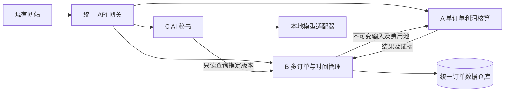

# 订单动态管理三模块开发接口设计

日期：2026-10-17；契约版本：1.0.0-draft。本文及配套 OpenAPI、示例是供三人开发使用的接口设计，尚未实现这些后端接口；当前网站仍是演示前端。

## 推荐结构

三个业务模块采用同一应用内的独立模块，通过统一 HTTP 网关接入网站。开发时可以分别运行或使用 mock，整合时优先一个后端进程、一个数据仓库，避免首版同时维护三个数据库和跨服务事务。接口不要求三人使用同一种内部实现方式，但输出必须符合共同契约。

## 三人责任与文件归属

以下是建议的新后端布局，不要求现在迁移旧项目。分支名可自行选择，不在此指定。

| 负责人 | 模块职责 | 独占目录 | 向其他模块交付 |
| --- | --- | --- | --- |
| A | 公式、计划与实际核算、可比性、成本偏差、风险判定、费用池分摊算法 | `backend/profit/`、`tests/profit/` | 纯函数核算入口、CalculationResult、Evidence |
| B | 订单主档、每日数据、导入批次、费用池资料、版本、计算调度、多订单汇总与查询 | `backend/orders/`、`backend/storage/`、`tests/orders/` | Snapshot、Portfolio、查询接口、稳定证据查询 |
| C | 对话、问题分类、上下文检索、模型适配、引用校验、人工反馈与训练数据准备 | `backend/assistant/`、`tests/assistant/` | AI 状态、对话任务和结构化回答 |

共同文件 `contracts/openapi.json`、网关路由、数据库迁移、前端 `dist/data.js` 由 B 担任整合维护人。A/C 提交接口变更建议，不同时改这些文件；算法输出新增可选字段可在评审后加入，删除或改变含义需升级契约版本。A 不直接改订单库，C 不直接改生产数据或计算结果。

## 必须先统一的事实

- A 是金额与利润算法的唯一提供方；B 负责求和及查询，但不另写一套毛利或风险公式；C 不重新核算确定性金额。
- B 是原始记录、基线版本和结果快照的唯一保存方。A 的计算输入和输出由 B 关联存储；C 保存自己的对话及审核记录。
- 一切结果按 `order_id + snapshot_id + baseline_id + formula_version + rule_version` 定位；同一订单不同天不是不同订单。
- “当天经营情况”按业务日期统计，“当时我们知道什么”还需按录入时间回放，两者不能混用。
- 毛利、经营净利、预计完工利润、已结算最终利润独立展示；未知为 null，明确无需且已确认才为零。

## 各成员应该读哪些文件

1. 三人共同阅读 `01_公共数据与版本约定.md` 和 `contracts/openapi.json`。
2. A 阅读 `02_A单订单利润核算.md`；B 阅读 `03_B多订单与时间管理.md`；C 阅读 `04_C本地AI秘书.md`。
3. 整合时按 `05_联调验收清单.md`，使用 `examples/` 中的合成数据固定对答案。

## 分阶段开发顺序

| 阶段 | A | B | C | 共同结果 |
| --- | --- | --- | --- | --- |
| 1 契约对齐 | 用固定输入实现核算纯函数 | 用静态快照实现查询 mock | 用固定快照实现上下文与回答校验 | 三人可独立运行自己的测试 |
| 2 模块实现 | 材料、人工、制造、利润与对照 | 每日更新、幂等、历史、汇总 | Ollama 适配与秘书式对话 | 模块分别可验收 |
| 3 首次整合 | 输出正式核算结果 | 串起资料→核算→快照 | 从真实快照引用数据 | 现有网站替换数据适配层 |
| 4 后续完善 | 预测口径与更多适配器 | 批量性能、权限、处理闭环 | 反馈审核、离线评测、必要时微调 | 使用同一版本集进行全流程验收 |

本轮不建立训练任务自动启动接口，也不把模型输出自动作为训练标签。先完成“真实事实→有依据的自然回答→人工审核”的闭环。

## 公式依据及待确认事项

核算原始依据为团队本地资料《企盈智擎_算法公式与说明汇总(1).docx》；仓库保留参考说明 `docs/reference/formula_v0.2.md` 和 `docs/reference/plan-margin-confirmed.md`。旧后端的 `engine.py`、`comparison.py`、`snapshots.py`、`ollama_client.py` 可从归档标签 `archive/pre-order-monitor-20261017` 下的 `profit_model/` 提取复用，但必须通过适配器映射到本契约，不能把其旧接口当成这里已实现。

仍须业务方确认：收入确认与税口径；实际材料净耗用如何处理领补退料及在制品；计件数量与工段定义；费用池期间及完整工时；经营费用范围；未完工预测方法。契约通过状态与缺失原因承接这些未知，不以默认值替代确认。三人可先按示例中已明确的合成口径开发。
